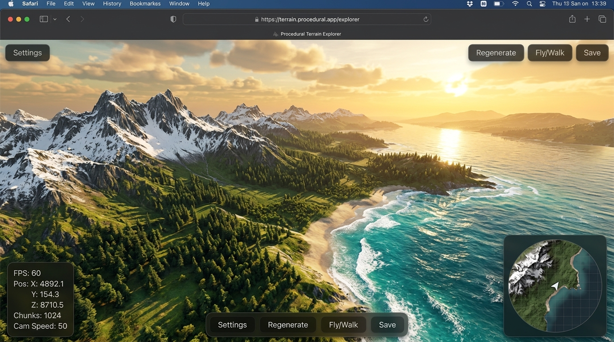
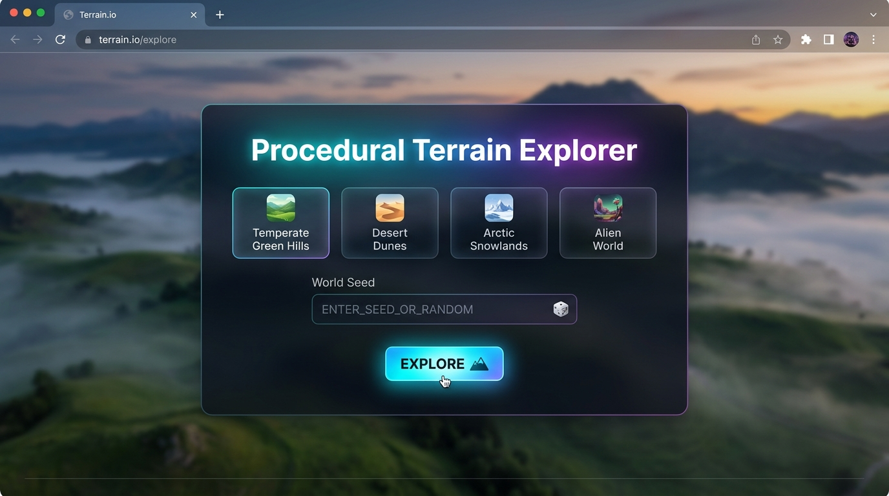
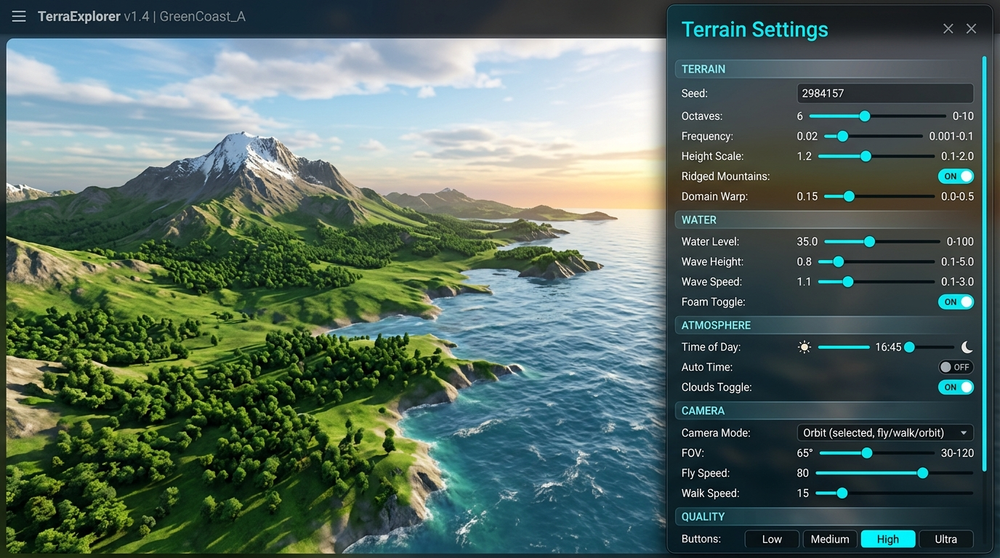
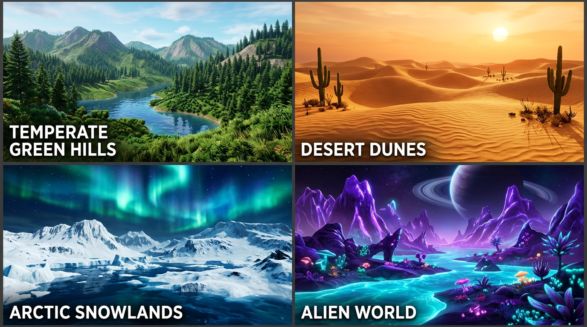

# 🌍 Procedural Terrain Explorer (Three.js + GLSL)

An infinite, explorable 3D landscape generator built entirely in vanilla JavaScript (ES Modules), **Three.js**, and custom **GLSL shaders**. Zero build tools, zero bundlers, and zero external textures—all terrain elevation, biomes, foliage, dynamic atmosphere, and water effects are generated procedurally in code.

---

## 🖼️ Screenshots

### 🌅 Main 3D Terrain View

> Infinite procedural landscape with snow-capped peaks, lush pine forests, sandy beaches, and a Gerstner ocean with foam. FPS counter and minimap overlay visible.

### 🚀 Start Screen — Biome & Seed Selection

> Choose your biome and enter a world seed before entering the 3D world. Seeds are synced to the URL for instant sharing.

### ⚙️ Real-Time Controls Panel

> All parameters (octaves, frequency, height scale, water level, wave height, time of day, camera mode, quality) are tunable live with instant terrain regeneration.

### 🌎 All Four Biomes

> Four built-in biome presets — each fully configures terrain shape, colors, vegetation, water, and atmosphere.

---

## 🚀 Quick Start

Because ES modules use browser `import` statements, run this project with any local HTTP static server:

```bash
# Option 1: Using npx serve (already running)
npx serve -l 8000 .

# Option 2: Using Python 3
python -m http.server 8000

# Option 3: Using Node http-server
npx http-server -p 8000
```

Then open your browser at **[http://localhost:8000](http://localhost:8000)**.

---

## 🎮 Controls & Navigation

| Action | Desktop | Mobile / Touch |
|---|---|---|
| **Look Around** | Mouse (Pointer Lock) | Drag right side of screen |
| **Move / Strafe** | <kbd>W</kbd> <kbd>A</kbd> <kbd>S</kbd> <kbd>D</kbd> | Left virtual joystick |
| **Fly Up / Jump** | <kbd>Space</kbd> | On-screen ▲ button |
| **Fly Down** | <kbd>Shift</kbd> or <kbd>C</kbd> | On-screen ▼ button |
| **Sprint / Boost** | <kbd>Ctrl</kbd> | On-screen ⚡ button |
| **Switch Modes** | <kbd>1</kbd> Fly, <kbd>2</kbd> Walk, <kbd>3</kbd> Orbit | Settings Dropdown |
| **Toggle Controls Panel** | <kbd>G</kbd> | ⚙ Top-right icon button |
| **Toggle Controls Help** | <kbd>H</kbd> | ? Top-right icon button |
| **Take Screenshot** | <kbd>P</kbd> | 📷 Top-right icon button |

---

## 🌟 Key Features

1. **Analytical Noise & Single Source of Truth:**
   - Powered by seedable 2D/3D Simplex noise, multi-octave fBm, ridged multi-fractal mountains, and domain warping.
   - All systems (mesh generation, walk physics, vegetation scattering, minimap) query a central `createTerrainSampler()` instance to ensure seamless visual and mechanical consistency.

2. **Seamless Multi-LOD Chunk Streaming:**
   - Endless terrain chunk loading around the camera.
   - Smooth transitions between 3 levels of detail (56, 28, and 14 segments).
   - **Downward Border Skirts** on every chunk eliminate LOD cracks and sub-pixel edge seams.
   - Asynchronous chunk queue (limited chunks per frame) and object pooling guarantee stutter-free 60 FPS flight.

3. **Multi-Band GLSL Shaders:**
   - Procedural height and slope blending: deep ocean $\rightarrow$ sand beach $\rightarrow$ valley grass $\rightarrow$ dense forest $\rightarrow$ cliff rocks $\rightarrow$ snow-capped peaks.
   - Dynamic Gerstner water shader with depth-color transitions, Fresnel reflection, Blinn-Phong sun specular highlights, and wave crest foam.

4. **Dynamic Day/Night Cycle & Atmosphere:**
   - 24-hour celestial orbit with real-time sun/moon coordinates.
   - Zenith-to-horizon gradient sky dome, night starfield particle fading, drifting low-poly clouds, and player-tracking shadow maps.

5. **Built-In Biome Presets:**
   - **Temperate Green Hills:** Verdant alpine valleys, pine forests, sandy shores.
   - **Desert Dunes:** Warm undulating sand ridges and saguaro cacti.
   - **Arctic Snowlands:** Glacial fjords, ice waters, frosted pines.
   - **Alien World:** Bioluminescent purple peaks, cyan oceans, exotic flora.

6. **Shareable Worlds via URL State:**
   - Changing the seed, biome, or noise parameters automatically syncs to `window.location.hash`, allowing instant link sharing.

---

## 🧩 Reusable Modules & APIs

You can import and reuse individual modules in your own Three.js or WebGL projects without modification:

### 1. Standalone Seedable Simplex Noise ([`js/noise/simplex.js`](file:///c:/Users/Senarios/Desktop/orbit/js/noise/simplex.js))
```javascript
import { createSimplex } from './js/noise/simplex.js';

const simplex = createSimplex('my-custom-seed');
const val2D = simplex.noise2D(x, y);
const val3D = simplex.noise3D(x, y, z);
```

### 2. Terrain Height & Normal Sampler ([`js/noise/terrainHeight.js`](file:///c:/Users/Senarios/Desktop/orbit/js/noise/terrainHeight.js))
```javascript
import { createTerrainSampler } from './js/noise/terrainHeight.js';

const sampler = createTerrainSampler({
  seed: 'Explorer2026',
  heightScale: 48,
  octaves: 5,
  frequency: 0.004,
  ridged: 0.25,
  warp: 25.0,
  island: false
});

const height = sampler.getHeight(x, z);
const normal = sampler.getNormal(x, z);
const slope = sampler.getSlope(x, z);
```

### 3. Reactive State Store ([`js/utils/state.js`](file:///c:/Users/Senarios/Desktop/orbit/js/utils/state.js))
```javascript
import { createState } from './js/utils/state.js';

const state = createState({ flySpeed: 36, quality: 'high' });
const unsubscribe = state.subscribe('flySpeed', (newVal) => console.log('Speed:', newVal));
state.set('flySpeed', 50);
```

### 4. Skirted Chunk Grid Builder ([`js/world/chunkGeometry.js`](file:///c:/Users/Senarios/Desktop/orbit/js/world/chunkGeometry.js))
```javascript
import { buildChunkGeometry } from './js/world/chunkGeometry.js';

// Generates a crack-free BufferGeometry with analytical normals & skirts
const geom = buildChunkGeometry(null, chunkX, chunkZ, chunkSize, segments, sampler);
```

---

## 🛠️ How to Contribute

Contributions are welcome! Follow these steps to add new features or enhancements:

### Adding a New Biome
1. Open [`js/config/biomes.js`](file:///c:/Users/Senarios/Desktop/orbit/js/config/biomes.js).
2. Add your biome configuration:
   ```javascript
   volcanic: {
     id: 'volcanic',
     name: 'Volcanic Caldera',
     heightScale: 60,
     ridged: 0.7,
     warp: 30.0,
     terrainColors: {
       deep: '#0f0f0f',
       sand: '#2b2b2b',
       grass: '#4a2319',
       forest: '#2e1913',
       rock: '#1a1818',
       snow: '#ff4500' // Glowing lava peak
     },
     waterColor: '#ff2a00',
     waterDeepColor: '#4a0800',
     // ...
   }
   ```
3. Add the option into [`js/ui/panelSchema.js`](file:///c:/Users/Senarios/Desktop/orbit/js/ui/panelSchema.js).

### Adding New UI Sliders or Toggles
1. Open [`js/ui/panelSchema.js`](file:///c:/Users/Senarios/Desktop/orbit/js/ui/panelSchema.js).
2. Add your control item to the schema list.
3. Define the default in [`js/config/defaults.js`](file:///c:/Users/Senarios/Desktop/orbit/js/config/defaults.js).
4. In [`js/main.js`](file:///c:/Users/Senarios/Desktop/orbit/js/main.js), connect `state.subscribe('key', handler)`.

### Code & Contribution Rules
- **No Bundler Dependencies:** Keep code compatible with browser ES modules.
- **Strict Line Limits:** Every `.js` file must be under 300 lines (absolute cap 400).
- **Single Responsibility:** Keep utilities, noise, shaders, world components, and UI widgets cleanly separated.

---

## 🤖 Agent Skills

This workspace includes an Antigravity agent skill located at:
- [`.agents/skills/procedural-terrain/SKILL.md`](file:///c:/Users/Senarios/Desktop/orbit/.agents/skills/procedural-terrain/SKILL.md)

AI agents working on this project automatically adhere to this skill guide when generating procedural assets, shaders, and UI controls.
